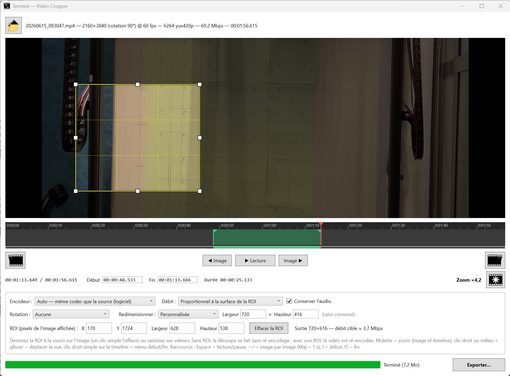

# Video Cropper (WPF / .NET 8)
Recadrage (ROI dessinée à la souris) et découpe temporelle d'une vidéo, via FFmpeg.

## Prérequis
- Windows 10/11, SDK .NET 8 (`winget install Microsoft.DotNet.SDK.8`)
- FFmpeg + ffprobe : copier `ffmpeg.exe` / `ffprobe.exe` 

## Utilisation
1. Ouvrir (ou glisser-déposer) une vidéo.
2. Naviguer avec le curseur / ←→ (image par image, Maj = 1 s).
3. Dessiner la ROI sur l'image (déplacer / redimensionner avec les poignées ; clic simple = effacer).
4. Placer le début (I) et la fin (O).
5. Choisir encodeur et débit, puis Exporter.

## Modes
- Sans ROI + « Copie » : aucune perte, coupe sur image clé.
- Avec ROI : ré-encodage. Encodeur « Auto » = même codec que la source. 
  Débit par défaut = débit source × (surface ROI / surface source).
  Les encodeurs matériels (NVENC, QSV, AMF) sont détectés par test réel.

